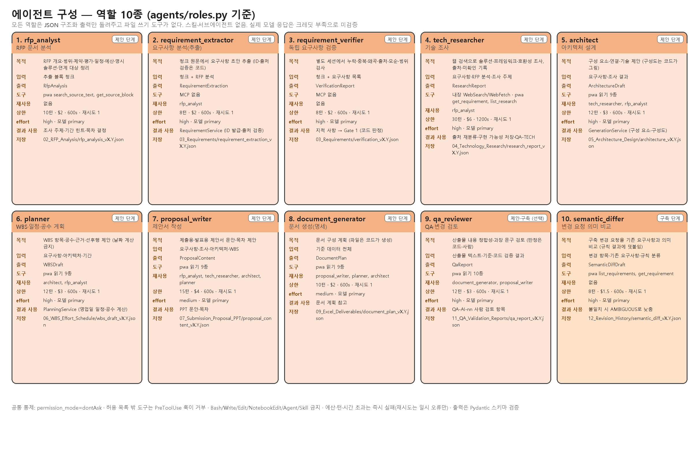
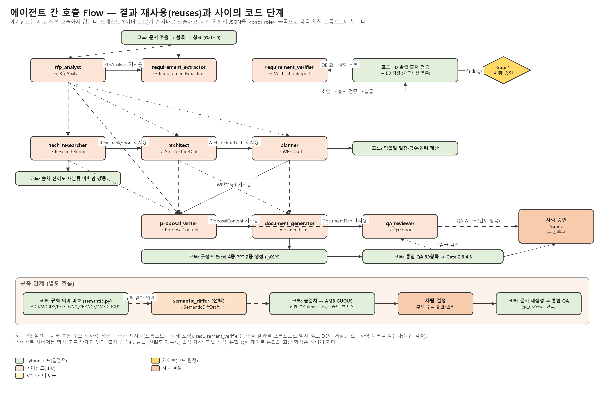
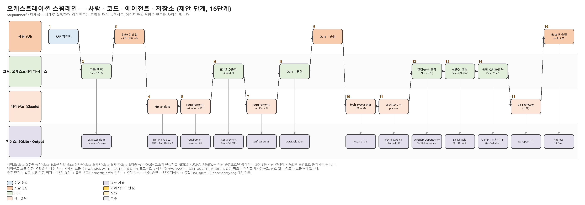

# AGENT_OVERVIEW — 에이전트 구성 · 역할 · 호출 Flow 한눈에 보기

작성일 2026-10-15 · 구현 기준 `agents/roles.py` · 그림 원본: `scripts/render_agent_diagrams.py` (Pillow) · 슬라이드: [AGENT_OVERVIEW.pptx](AGENT_OVERVIEW.pptx)
관련: [AGENT_DESIGN.md](AGENT_DESIGN.md)(권한·실패 처리 상세), [FLOW_DIAGRAM.md](FLOW_DIAGRAM.md)(시스템 전체 흐름), [MCP_CONFIGURATION.md](MCP_CONFIGURATION.md)

---

## 1. 한 문단 요약

에이전트는 **역할 10종**이며 서로 직접 호출하지 않는다. 오케스트레이터(Python 코드 `StepRunner`·서비스)가 단계 순서대로 역할을 하나씩 호출하고, 이전 역할의 JSON 결과를 다음 역할의 프롬프트에 `<prior role="…">` 블록으로 넣어 준다(결과 재사용). 에이전트가 돌려주는 것은 Pydantic 스키마로 검증되는 **JSON 구조화 출력**뿐이고, ID 발급·일정 계산·파일 생성·QA·게이트 판정은 코드가, 게이트 승인과 변경 승인은 사람이 한다. 스킬·서브에이전트는 쓰지 않으며 도구는 `pwa` MCP 읽기 10종과 (기술 조사 역할만) 내장 WebSearch/WebFetch다.

> 실제 Claude 모델 응답은 크레딧 부족으로 검증하지 못했다. 역할 정의·프롬프트·스키마·연결은 구현되어 있고, 모의 응답(FakeAgentRunner)으로 흐름을 검증했다 ([TEST_RESULTS.md](TEST_RESULTS.md)).

## 2. 에이전트 구성 (역할 카드)

| # | 역할 | 단계 | 목적 | 입력 | 출력 스키마 | 도구 | 재사용하는 이전 출력 | 턴 · $ · 초 |
|---|---|---|---|---|---|---|---|---|
| 1 | `rfp_analyst` | 제안 | RFP 개요·범위·제약·평가·일정·예산·명시 솔루션·연계 대상 정리 | 추출 블록 청크 | `RfpAnalysis` | pwa `search_source_text`, `get_source_block` | — | 10 · 2 · 600 |
| 2 | `requirement_extractor` | 제안 | 청크 원문에서 요구사항 초안 추출 | 청크 + RFP 분석 | `RequirementExtraction` | 없음 | rfp_analyst | 8 · 2 · 600 |
| 3 | `requirement_verifier` | 제안 | 별도 세션에서 누락·중복·왜곡·출처·모순·범위 검사 | 청크(검증 창) + DB의 요구사항 목록 | `VerificationReport` | 없음 | — (추출 세션과 분리) | 8 · 2 · 600 |
| 4 | `tech_researcher` | 제안 | 솔루션·프레임워크·호환성 웹 조사, 출처·미확인 기록 | 요구사항·RFP 분석·조사 주제 | `ResearchReport` | WebSearch, WebFetch, pwa `get_requirement`, `list_research` | rfp_analyst | 30 · 6 · 1200 |
| 5 | `architect` | 제안 | 구성 요소·연결·기술 제안 | 요구사항·조사 결과 | `ArchitectureDraft` | pwa 읽기 9종 | tech_researcher, rfp_analyst | 12 · 3 · 600 |
| 6 | `planner` | 제안 | WBS 항목·공수·근거·선후행 제안 (날짜 금지) | 요구사항·아키텍처·기간 | `WBSDraft` | pwa 읽기 9종 | architect, rfp_analyst | 12 · 3 · 600 |
| 7 | `proposal_writer` | 제안 | 제출용·발표용 문안·목차 | 요구사항·조사·아키텍처·WBS | `ProposalContent` | pwa 읽기 9종 | rfp_analyst, tech_researcher, architect, planner | 15 · 4 · 600 |
| 8 | `document_generator` | 제안 | 문서 구성 계획 (파일은 코드) | 기준 데이터 전체 | `DocumentPlan` | pwa 읽기 9종 | proposal_writer, planner, architect | 10 · 2 · 600 |
| 9 | `qa_reviewer` | 제안·구축(선택) | 산출물 내용 정합성·과장 문구 검토 | 산출물 텍스트·기준·코드 검증 결과 | `QaReport` | pwa 읽기 9종 + `verify_deliverable_file` | document_generator, proposal_writer | 12 · 3 · 600 |
| 10 | `semantic_differ` | 구축(선택) | 변경 요청을 기존 요구사항과 의미 비교 | 변경 항목·기존 요구사항·규칙 분류 | `SemanticDiffDraft` | pwa `list_requirements`, `get_requirement` | — (규칙 결과를 입력으로) | 8 · 1.5 · 600 |

재시도는 모두 1회(일시 오류만), effort는 7·8번만 `medium`, 나머지 `high`, 모델은 모두 `primary`(`PWA_MODEL_PRIMARY`). 결과 JSON은 `Output/<프로젝트>/<하위 폴더>/<stem>_vX.Y.json`과 `AgentOutput` 레코드로 남는다.

## 3. 에이전트 간 호출 Flow (결과 재사용 그래프)

읽는 법:

- **실선**은 이름을 붙인 주요 재사용, **점선**은 함께 프롬프트에 들어가는 추가 재사용이다. `rfp_analyst` 결과는 2·4·5·6·7번이 모두 참고한다.
- `requirement_verifier`는 추출 에이전트의 결과를 프롬프트로 받지 않는다. 코드가 ID를 발급하고 출처를 검증해 DB에 저장한 **요구사항 목록**을 받는다(독립 검증).
- 에이전트와 에이전트 사이에는 항상 코드 단계가 있다: 출처 검증·ID 발급(2→3), 출처 신뢰도 재분류(4→5), 영업일 일정·공수·인력 계산(6→파일 생성), 파일 생성(7·8→QA), 통합 QA 30항목(→Gate 2·3·4·5).
- `qa_reviewer`의 결과는 QA 판정을 바꾸지 않고 "사람 검토 항목(QA-AI-nn)"으로만 추가된다.
- 구축 단계는 별도 흐름이다. 규칙 기반 의미 비교(코드)가 먼저 분류하고, `semantic_differ`는 선택적으로 의견을 덧붙이며, 규칙과 다르면 AMBIGUOUS로 낮춰 사람이 결정한다. 영향 분석·반영·문서 재생성은 모두 코드다.

## 4. 오케스트레이션 스윔레인 (제안 단계 16단계)

| 단계 | 주체 | 내용 | 게이트 / 기록 |
|---|---|---|---|
| 1 | 사람 | RFP 업로드 (DOCX/TXT/PDF) | `01_RFP_Original` 보존 |
| 2 | 코드 | 추출(pdfplumber·docx·OCR) → 블록 → 청크 | Gate 0 판정, `ExtractedBlock` |
| 3 | 사람 | Gate 0 승인 (검토 필요 시) | `Approval` |
| 4 | 에이전트 | `rfp_analyst` | `02_RFP_Analysis/rfp_analysis_vX.Y.json` |
| 5 | 에이전트 | `requirement_extractor` × 청크 (신호 없는 청크 건너뜀, 캐시 재사용) | `03_Requirements/requirement_extraction_vX.Y.json` |
| 6 | 코드 | 출처 검증·ID 발급·중복 병합 | `Requirement`·`SourceRef` |
| 7 | 에이전트 | `requirement_verifier` × 검증 창(추출 청크의 2배) + 교차 검사 1회 | `verification_vX.Y.json`, `ValidationResult` |
| 8 | 코드 | Gate 1 판정 | `GateEvaluation` |
| 9 | 사람 | Gate 1 승인 (검토 의견 필수, FAIL은 승인 불가) | `Approval` |
| 10 | 에이전트 | `tech_researcher` (웹 검색) → 코드가 출처 신뢰도 재분류 | `04_Technology_Research/research_vX.Y.json` |
| 11 | 에이전트 | `architect` → `planner` (각 1회) | `05_Architecture_Design`, `06_WBS_Effort_Schedule` JSON |
| 12 | 코드 | 영업일 일정·공수·인력 계산 (planner 날짜는 쓰지 않음) | `WBSItem`·`Dependency`·`StaffRole`·`Allocation` |
| 13 | 코드 | 구성도·Excel 4종·PPT 2종 생성 (`proposal_writer`·`document_generator`는 문안·계획만 제공) | `Deliverable`, `06_~10_` 파일 |
| 14 | 코드 | 통합 QA 30항목, 재생성 자동 수정 ≤ N회 | Gate 2·3·4·5 판정, `QaRun`, `11_QA_Validation_Reports` |
| 15 | 에이전트 | `qa_reviewer` (선택) | QA-AI-nn 검토 항목 |
| 16 | 사람 | Gate 5 승인 → 최종본 복사 | `13_Final_Deliverables` |

구축 단계: 기존 Excel 적재(코드) → 변경 요청 등록(사람) → 규칙 의미 비교(코드) [+ `semantic_differ`] → 영향 분석(코드) → 후보 결정·승인/반려(사람) → 트랜잭션 반영·문서 재생성(코드) → 변경 후 통합 QA(코드) [+ `qa_reviewer`] → Gate 5 승인(사람).

## 5. 호출 1회가 지나는 통제 (모든 역할 공통)

| 통제 | 내용 |
|---|---|
| 권한 | `permission_mode=dontAsk`, 역할이 선언한 `allowed_tools`만 전달. Bash·Write·Edit·NotebookEdit·Agent·Skill·KillShell은 어떤 역할에도 없음 |
| 훅 | PreToolUse: 허용 목록 밖·금지 도구·내부/사설 IP URL 거부(감사 기록). PostToolUse: 도구 호출 기록(비밀값 마스킹). `can_use_tool` 폴백 |
| 상한 | 역할별 `max_turns`·`max_budget_usd`·`timeout_s`·`retries`(위 표). 단계당 예산 `PWA_MAX_BUDGET_USD_PER_STEP`(역할 상한은 3배까지) |
| 호출 수·누적 비용 | 추출·검증은 실행 전 계획(청크·호출·캐시·최대 비용)을 산정해 `PWA_MAX_AGENT_CALLS_PER_STEP`, `PWA_MAX_BUDGET_USD_PER_PROJECT`를 넘으면 호출 전에 중단. 같은 청크는 캐시 재사용 |
| 출력 | JSON 스키마(`output_format`) → Pydantic 검증. 실패·예산 초과·턴 초과는 즉시 `AgentRunError`, 일시 오류만 재시도 |
| 기록 | `AgentOutput`(파일 경로·sha256·비용·턴·도구 호출 수), 감사 이벤트, `StepRun.cost_usd` |

## 6. 파일

| 파일 | 내용 |
|---|---|
| `docs/diagrams/agent_01_roster.png` | 역할 카드 10종 |
| `docs/diagrams/agent_02_dependency.png` | 결과 재사용 그래프 + 코드 단계 + 구축 흐름 |
| `docs/diagrams/agent_03_orchestration.png` | 스윔레인 16단계 |
| `docs/AGENT_OVERVIEW.pptx` | 표지 + 그림 3장 + 역할 표 |
| `scripts/render_agent_diagrams.py` | 재생성 (`python scripts\render_agent_diagrams.py`, roles.py 값을 직접 읽음) |
