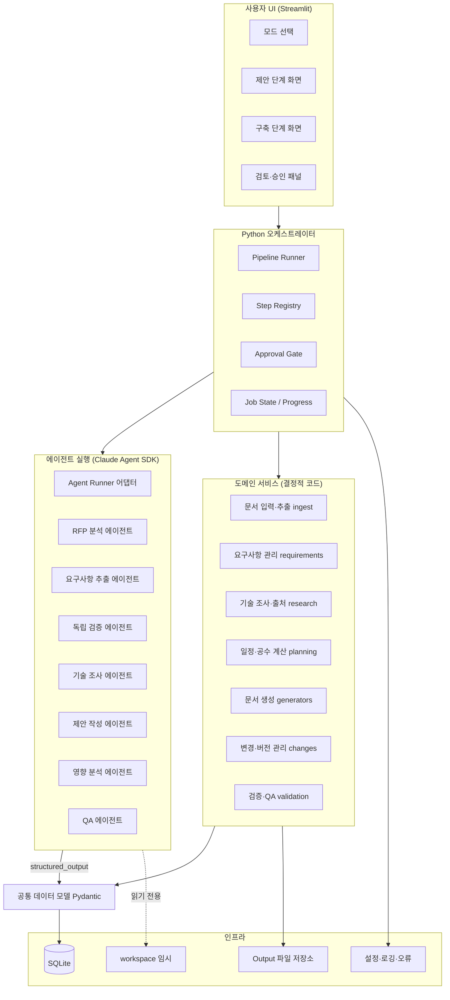
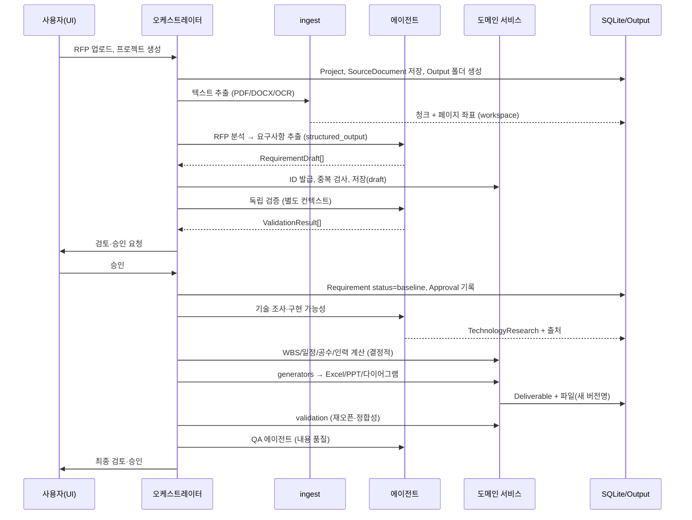

# ARCHITECTURE — 시스템 아키텍처 설계

문서 버전 0.1 · 2026-10-15 · 관련: [PROJECT_OVERVIEW.md](PROJECT_OVERVIEW.md), [DATA_MODEL.md](DATA_MODEL.md), [AGENT_DESIGN.md](AGENT_DESIGN.md)

---

## 1. 설계 원칙

1. **결정적 계산과 LLM 판단의 분리**: ID 발급, 날짜·공수 계산, 선후행 검증, 파일 경로·버전, 필수 컬럼 검사는 순수 Python. 요구사항 의미 해석, 기술 조사, 제안 문안, 변경 영향의 의미 분석은 에이전트.
2. **단일 기준 데이터(Single Source of Truth)**: 모든 산출물(Excel, PPT, 다이어그램)은 SQLite에 저장된 프로젝트 데이터에서 생성된다. 생성 파일을 직접 수정해 기준으로 삼지 않는다.
3. **승인 게이트**: 에이전트 결과는 `draft` 상태로 저장되고, 사람의 승인 후에만 기준 데이터(`baseline`)가 된다.
4. **불변 이력**: 요구사항 ID는 재발급하지 않고, 삭제는 상태 변경으로만 처리한다. 모든 변경은 `AuditEvent`로 남긴다.
5. **파일 보존**: 기존 파일은 덮어쓰지 않고 항상 새 버전 파일명으로 저장한다.
6. **경로 중앙 관리**: 모든 경로는 `config/paths.py`의 `ProjectPaths`(pathlib)에서만 생성한다.
7. **에이전트 권한 최소화**: 서브에이전트마다 허용 도구를 명시하고, 파일 쓰기는 오케스트레이터가 지정한 workspace 하위로 제한한다.

## 2. 레이어 구성



### 레이어별 책임

| 레이어 | 패키지 | 책임 | 금지 사항 |
|---|---|---|---|
| UI | `ui/` | 모드 선택, 입력 수집, 진행 상태 표시, 검토·승인 | 비즈니스 로직 직접 수행, DB 직접 접근 |
| 오케스트레이터 | `orchestrator/` | 파이프라인 단계 실행 순서, 상태 전이, 승인 게이트, 재시도 | 문서 포맷 지식, LLM 프롬프트 내용 |
| 에이전트 | `agents/` | 역할별 `AgentDefinition`, 프롬프트, 구조화 출력 스키마, Agent SDK 호출 | 결정적 계산(날짜·공수·ID), 파일 덮어쓰기 |
| 도메인 서비스 | `ingest/ requirements/ research/ planning/ generators/ changes/ validation/` | 결정적 로직 | LLM 직접 호출 |
| 공통 모델 | `models/` | Pydantic 엔티티, enum, 스키마 export | I/O |
| 저장소 | `storage/` | SQLite 리포지토리, 파일 저장소, 버전 파일명 | 비즈니스 규칙 |
| 설정·로깅 | `config/` | 경로, 환경변수, 로깅, 예외 계층 | — |

## 3. 디렉터리 구조

```
Proposal_Writer_Agent/
├── pyproject.toml
├── README.md                         (Phase 1)
├── .env.example                      (Phase 1)  ANTHROPIC_API_KEY 등
├── docs/                             설계 문서
├── src/proposal_agent/
│   ├── __init__.py
│   ├── app.py                        Streamlit 진입점 (st.navigation)        [Phase 1 구현]
│   ├── ui/                                                                   [Phase 1 구현]
│   │   ├── app_pages/home.py         모드 선택, 신규 생성, 기존 열기
│   │   ├── app_pages/project.py      입력 문서·진행 상태·이슈·저장 위치·승인
│   │   ├── components.py             단계 표, 이슈 패널, 승인 이력 (값 객체만 그림)
│   │   └── state.py                  st.session_state 래퍼, 서비스 접근, 오류 표시
│   ├── services/                     애플리케이션 서비스 (UI ↔ 도메인/저장소)   [Phase 1 구현]
│   │   ├── context.py                AppContext: 설정·경로·DB·리포지토리 조립
│   │   ├── project_service.py        프로젝트 생성·조회·열기·저장 위치
│   │   ├── document_service.py       입력 문서 등록, 모드별 필수 문서 규칙
│   │   ├── pipeline_service.py       모드별 단계 정의, StepRun 상태 전이, 게이트, 이슈
│   │   ├── agent_step_service.py     역할 실행: 요청 조립(도구·MCP), 이전 출력 재사용, JSON 산출물 버전 저장, 감사   [Phase 3]
│   │   └── audit.py                  감사 이벤트 기록 (비밀값 마스킹)
│   │   ├── app_pages/extraction.py   문서별 추출 결과·OCR 페이지·경고·재처리, Gate 0        [Phase 2]
│   │   └── app_pages/requirements.py 추출·검증 실행, 목록·원본 위치·검토·수정·승인, Gate 1  [Phase 2]
│   ├── orchestrator/                                                         [Phase 2 구현]
│   │   ├── gates.py                  GateService: PASS/FAIL/NEEDS_HUMAN_REVIEW 유효 상태, 사람 승인·반려, require()
│   │   ├── runner.py                 StepRunner: 추출→Gate0, 요구사항 추출(Gate0 필요), 검증→Gate1, 생성 진입 검사
│   │   └── jobs.py                   (Phase 3~) 비동기 작업 상태 (Streamlit ↔ asyncio 브리지)
│   ├── agents/                                                               [Phase 3 구현]
│   │   ├── roles.py                  9개 역할 정의 (입력·출력 스키마·도구·MCP·턴·예산·시간·재시도·재사용)
│   │   ├── runner.py                 ClaudeSDKClient 어댑터: 역할별 tools/allowed_tools/mcp_servers, 훅, can_use_tool,
│   │   │                             시간 제한·취소(interrupt)·일시 오류 재시도·비용/도구 호출 기록, test_connection; FakeAgentRunner
│   │   ├── control.py                CancellationToken, ToolPolicy(금지 도구·허용 폴더·웹 URL 규칙), 도구 호출 기록(비밀값 마스킹)
│   │   ├── hooks.py                  PreToolUse(정책 deny/allow), PostToolUse(기록), can_use_tool 폴백
│   │   ├── tools/project_tools.py    인프로세스 SDK MCP 서버 `pwa` (읽기 전용 조회 9종 + 산출물 파일 검증)
│   │   ├── prompts/                  9개 역할 시스템 프롬프트 (.md)
│   │   └── schemas.py                역할별 구조화 출력 스키마 (RfpAnalysis, ResearchReport, ArchitectureDraft, WBSDraft, ProposalContent, DocumentPlan, QaReport …)
│   ├── research/                                                             [Phase 3 구현]
│   │   ├── sources.py                출처 신뢰도 도메인 규칙 (official_doc/standard/vendor_guide/community/unknown)
│   │   └── service.py                조사 주제 식별(결정적), 조사 실행, 출처 재분류·미확인 강등, 구현 가능성 비교 저장
│   ├── models/
│   │   ├── enums.py
│   │   ├── project.py                Project, ProjectMode, SourceDocument
│   │   ├── requirement.py            Requirement, RequirementChange, RequirementTrace
│   │   ├── design.py                 Screen, ArchitectureComponent, TechnologyResearch
│   │   ├── test.py                   UnitTest, IntegrationTest
│   │   ├── planning.py               WBSItem, Dependency, StaffRole, StaffingAllocation
│   │   ├── deliverable.py            Deliverable, ValidationResult, Approval, Revision
│   │   └── audit.py                  AuditEvent
│   ├── ingest/                                                               [Phase 2 구현]
│   │   ├── base.py                   ReaderResult, BlockBuilder, 제목/목록/목차 휴리스틱, 섹션 추적
│   │   ├── pdf_reader.py             pdfplumber(텍스트·표) + pypdf(암호화·손상) + pypdfium2(스캔 렌더링→OCR)
│   │   ├── docx_reader.py            python-docx 본문 순서(문단·표), 페이지 번호는 기록하지 않음
│   │   ├── txt_reader.py             인코딩 자동 판별, 줄 번호 위치
│   │   ├── ocr.py                    OCR 플러그인 (rapidocr 한국어, Null 엔진)
│   │   ├── chunker.py                블록 → LLM 청크 (<block id> 태그, 표 분할 금지, 목차 제외)
│   │   ├── service.py                ExtractionService: 형식 판별·추출·블록 저장·Gate 0 (코드 판정)
│   │   └── excel_reader.py           (Phase 6) 구축 단계 기존 산출물 파싱
│   ├── requirements/                                                         [Phase 2 구현]
│   │   ├── id_policy.py              설정 가능한 접두사(FR/NFR/CON/EVA/SUB) ID 발급, 재발급 금지, 재추출 매칭
│   │   ├── service.py                RequirementService: 청크별 추출·독립 검증, 출처 검증, 사람 검토·수정·삭제, Gate 1
│   │   ├── diff.py                   (Phase 6) 기존 vs 신규 요구사항 구조적 비교
│   │   └── trace.py                  (Phase 4) 추적표 매트릭스 구성
│   ├── research/
│   │   ├── sources.py                출처 레코드, 공식 문서 우선순위
│   │   └── feasibility.py            구현 가능성 판정 스키마 병합
│   ├── planning/
│   │   ├── calendar.py               영업일 계산, 공휴일
│   │   ├── scheduler.py              선후행 관계 검증, CPM 일정 계산
│   │   ├── effort.py                 공수 합계, M/M 환산
│   │   └── staffing.py               인력 투입 계획, 비용 계산
│   ├── generators/
│   │   ├── base.py                   Generator 추상, 출력 경로·버전 규칙
│   │   ├── excel/                    요구사항정의서, 추적표, WBS·간트, 인력계획
│   │   ├── pptx/                     제출용, 발표용
│   │   ├── diagrams/                 시스템·SW·서비스 구성도 (matplotlib)
│   │   └── summary.py                00_Project_Summary
│   ├── changes/
│   │   ├── change_request.py         변경 요청 수명주기
│   │   ├── impact.py                 영향 대상 식별 (결정적 부분: 추적표 그래프 탐색)
│   │   └── versioning.py             Revision 생성, 파일 버전명, 변경 이력 보존
│   ├── validation/
│   │   ├── file_integrity.py         생성 파일 재오픈·필수 시트·컬럼 검사
│   │   ├── consistency.py            문서 간 정합성 (요구사항 수, ID 일치 등)
│   │   └── rules.py                  규칙 레지스트리
│   ├── storage/                                                              [Phase 1 구현]
│   │   ├── db.py                     SQLite 연결(잠금, WAL), 마이그레이션 적용
│   │   ├── migrations.py             버전별 SQL (추가 전용)
│   │   ├── repositories.py           엔티티별 Repository (조회 컬럼 + data JSON)
│   │   └── files.py                  덮어쓰기 금지 저장, 중복 파일명, 버전 파일명, 해시
│   └── config/                                                               [Phase 1 구현]
│       ├── settings.py               .env/환경변수 로드, dev/prod 구분, 키 마스킹
│       ├── paths.py                  ProjectPaths, OUTPUT_SUBDIRS, ensure_within(경로 탈출 차단)
│       ├── logging.py                파일(회전)+콘솔 로거
│       └── errors.py                 예외 계층 (message/cause/resolution)
├── tests/
│   ├── unit/
│   ├── integration/
│   └── fixtures/                     샘플 RFP, 샘플 Excel
├── Output/<Project_YYYYMMDD_이름>/00_… ~ 13_…
├── workspace/<project_id>/           에이전트 임시 파일, 추출 텍스트
└── scripts/                          개발 보조 스크립트
```

## 4. 산출물 폴더 규칙

`config/paths.py`가 단일 정의:

```python
OUTPUT_SUBDIRS = (
    "00_Project_Summary", "01_RFP_Original", "02_RFP_Analysis", "03_Requirements",
    "04_Technology_Research", "05_Architecture_Design", "06_WBS_Effort_Schedule",
    "07_Submission_Proposal_PPT", "08_Presentation_PPT", "09_Excel_Deliverables",
    "10_Diagrams_Charts_Images", "11_QA_Validation_Reports", "12_Revision_History",
    "13_Final_Deliverables",
)
```

- 프로젝트 폴더: `Project_YYYYMMDD_<slug>`; 동일 이름 존재 시 `_<6자리 short id>` 추가.
- 파일 버전: `<문서종류>_v<major>.<minor>.<ext>` (예: `요구사항정의서_v1.0.xlsx`). 구축 단계 변경 승인 시 minor 증가, 기준선 재설정 시 major 증가.
- 덮어쓰기 금지: 같은 경로가 있으면 저장 실패로 처리하고 호출자가 새 버전명을 요청.

## 5. 에이전트 실행 어댑터 (Agent SDK 사용 방식)

확인된 SDK 0.2.165 API 기준.

```python
# agents/runner.py (설계 스케치)
from claude_agent_sdk import (
    query, ClaudeAgentOptions, AgentDefinition, ResultMessage,
    HookMatcher, create_sdk_mcp_server,
)

async def run_structured(prompt: str, schema_model: type[BaseModel], *,
                         cwd: Path, allowed_tools: list[str],
                         agents: dict[str, AgentDefinition] | None = None,
                         max_budget_usd: float, max_turns: int) -> BaseModel:
    options = ClaudeAgentOptions(
        cwd=cwd,                                   # workspace/<project_id>
        system_prompt=load_prompt("..."),
        allowed_tools=allowed_tools,               # 예: ["Read", "Glob", "Grep", "WebSearch", "WebFetch", "Agent"]
        disallowed_tools=["Bash", "Edit", "Write", "NotebookEdit"],   # 기본 쓰기 금지
        agents=agents,
        output_format={"type": "json_schema", "schema": schema_model.model_json_schema()},
        hooks={"PreToolUse": [HookMatcher(matcher="Write|Edit", hooks=[deny_outside_workspace])]},
        max_budget_usd=max_budget_usd,
        max_turns=max_turns,
        model=settings.model_primary,
        permission_mode="dontAsk",                 # 허용 목록 외 도구는 자동 거부 (UI에서 프롬프트 불가)
        env={"CLAUDE_CODE_MAX_SUBAGENT_SPAWN_DEPTH": "1"},
    )
    async for msg in query(prompt=prompt, options=options):
        if isinstance(msg, ResultMessage):
            if msg.subtype == "success" and msg.structured_output:
                return schema_model.model_validate(msg.structured_output)
            raise AgentRunError(msg.subtype, msg)
```

핵심 결정:

| 결정 | 근거 |
|---|---|
| `query()` 단발 호출을 기본으로, 대화형 검토 화면에만 `ClaudeSDKClient` 사용 | 파이프라인 단계는 입력→구조화 출력의 함수형 호출이 재현·테스트에 유리 |
| 구조화 출력(`output_format` + Pydantic) 필수 | 결과를 파싱 없이 데이터 모델로 수용, 검증 실패 시 `error_max_structured_output_retries`로 명확히 실패 |
| 파일 쓰기는 에이전트에게 주지 않고, 구조화 출력을 받아 Python generator가 파일 생성 | 덮어쓰기 금지·무결성 검사·버전 규칙을 코드로 보장 |
| 기술 조사는 내장 `WebSearch`/`WebFetch` 사용 | Claude API 서버 도구로 제공됨(확인). 별도 검색 MCP 불필요. Bedrock 사용 시 대체 필요(RISK R-04) |
| 프로젝트 데이터 조회는 인프로세스 SDK MCP 도구(`@tool`)로 제공 | 에이전트가 DB 파일을 직접 읽지 않고 리포지토리 API를 통해 읽기 전용 접근 |
| `max_budget_usd`, `max_turns`, 서브에이전트 깊이 1 | 비용·폭주 방지 |
| `permission_mode="dontAsk"` | Streamlit 환경에서는 권한 프롬프트를 띄울 수 없음. 허용 목록으로만 제어 |

Streamlit은 동기 실행 모델이므로 `orchestrator/jobs.py`가 `asyncio` 루프를 별도 스레드에서 돌리고, 진행 상황을 `st.session_state`와 SQLite 작업 테이블로 전달한다 (RISK R-06).

## 6. 데이터 흐름 (제안 단계)



구축 단계 흐름은 [WORKFLOW_DESIGN.md](WORKFLOW_DESIGN.md) 참고.

## 7. 설정·로깅·오류 처리

- **설정**: `.env` → `config/settings.py`(pydantic `BaseSettings` 또는 수동 로드). 필수: `ANTHROPIC_API_KEY`. 선택: `PWA_MODEL_PRIMARY`, `PWA_MODEL_WORKER`, `PWA_MAX_BUDGET_USD_PER_STEP`, `PWA_OUTPUT_ROOT`, `PWA_DB_PATH`.
- **로깅**: `logging` 표준 모듈, 파일 핸들러(`workspace/logs/app.log`) + 콘솔. 에이전트 호출마다 `AuditEvent`에 모델, 비용(`ResultMessage.total_cost_usd`), 턴 수, 결과 상태 기록.
- **오류 계층**: `PWAError` → `ConfigError`, `IngestError`, `AgentRunError`, `ValidationError`(도메인), `StorageError`, `FileExistsConflict`. 모든 오류는 원인·권장 조치 메시지 필드를 가진다.
- **재시도**: 에이전트 호출은 구조화 출력 실패 시 1회 재시도(프롬프트에 오류 요약 첨부). 네트워크 오류는 SDK 재시도에 위임.

## 8. 보안·권한

- API 키는 환경변수로만. 로그·AuditEvent에 기록 금지.
- 에이전트 `cwd`는 `workspace/<project_id>`; `add_dirs`로 `Output/<project>/01_RFP_Original` 읽기만 허용.
- `PreToolUse` 훅으로 `Write|Edit` 호출 시 workspace 밖 경로를 거부.
- `Bash`는 기본 비허용. 필요한 역할(없음 예정)에만 명시 허용.
- 구축 단계 업로드 문서는 신뢰할 수 없는 입력으로 취급: 문서 내 지시문을 에이전트 지시로 해석하지 않도록 프롬프트에 명시하고, 추출 텍스트는 데이터 블록으로 전달.
