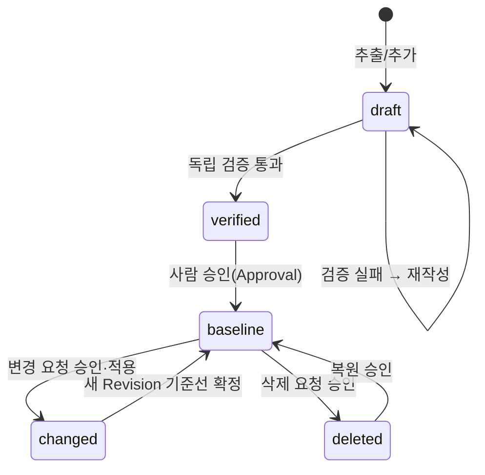

# DATA_MODEL — 공통 데이터 모델 및 데이터 흐름

문서 버전 0.1 · 2026-10-15 · 관련: [ARCHITECTURE.md](ARCHITECTURE.md), [WORKFLOW_DESIGN.md](WORKFLOW_DESIGN.md)

---

## 1. 모델링 원칙

- Pydantic v2 `BaseModel`로 정의하고, 동일 모델을 (a) SQLite 저장, (b) 에이전트 구조화 출력 스키마(`model_json_schema()`), (c) 문서 생성 입력에 공용으로 사용한다. 에이전트 출력용은 `*Draft` 서브셋 모델로 분리해 ID·상태·감사 필드를 LLM이 채우지 못하게 한다.
- 모든 엔티티의 PK는 애플리케이션이 발급하는 문자열 ID. 요구사항처럼 사람이 읽는 ID는 `id_policy.py`가 결정적으로 발급하고 재발급하지 않는다.
- 삭제는 물리 삭제 없이 `status` 변경 + `AuditEvent`.
- 시각은 UTC ISO-8601 문자열로 저장, UI에서 로컬 변환.
- 모든 엔티티에 `created_at`, `updated_at`, `created_by`(사용자 또는 에이전트 이름)를 둔다.

## 2. 엔티티 관계도

```mermaid
erDiagram
    Project ||--o{ SourceDocument : has
    Project ||--o{ Requirement : has
    Project ||--o{ WBSItem : has
    Project ||--o{ StaffRole : defines
    Project ||--o{ TechnologyResearch : has
    Project ||--o{ ArchitectureComponent : has
    Project ||--o{ Deliverable : produces
    Project ||--o{ Revision : versions
    Project ||--o{ AuditEvent : logs
    Project ||--o{ Screen : has
    Project ||--o{ Approval : has

    SourceDocument ||--o{ Requirement : "source_refs"
    Requirement ||--o{ RequirementChange : history
    Requirement ||--o{ RequirementTrace : traced_by
    RequirementTrace }o--o| Screen : to
    RequirementTrace }o--o| WBSItem : to
    RequirementTrace }o--o| UnitTest : to
    RequirementTrace }o--o| IntegrationTest : to
    RequirementTrace }o--o| ArchitectureComponent : to
    Requirement }o--o{ TechnologyResearch : evaluated_by
    Requirement ||--o{ ValidationResult : validated_by

    WBSItem ||--o{ Dependency : predecessor
    WBSItem ||--o{ Dependency : successor
    WBSItem ||--o{ StaffingAllocation : staffed_by
    StaffRole ||--o{ StaffingAllocation : role

    Deliverable ||--o{ ValidationResult : checked_by
    Deliverable }o--|| Revision : belongs_to
    Revision ||--o{ RequirementChange : includes
    Revision ||--o| Approval : approved_by
    RequirementChange }o--o| Approval : approved_by
```

## 3. 공통 enum

| enum | 값 |
|---|---|
| `ProjectMode` | `proposal`, `build` |
| `ProjectStatus` | `created`, `analyzing`, `requirements_review`, `researching`, `planning`, `generating`, `qa`, `approved`, `archived` |
| `DocumentKind` | `rfp`, `rfp_attachment`, `requirement_spec`, `trace_matrix`, `wbs`, `staffing_plan`, `other` |
| `RequirementType` | `functional`, `non_functional` |
| `RequirementCategory` | 기능: `ui`, `business`, `data`, `interface`, `report`, `admin` / 비기능: `performance`, `security`, `availability`, `compatibility`, `operability`, `constraint`, `other` |
| `ScopeClass` | `mandatory`(RFP 필수), `optional_proposal`(선택 제안), `out_of_scope`(과잉 범위) |
| `AcceptanceStatus` | `proposed`, `accepted`, `partially_accepted`, `rejected`, `deferred` |
| `RequirementStatus` | `draft`, `verified`, `baseline`, `changed`, `deleted` |
| `VerificationStatus` | `unverified`, `verified`, `needs_revision`, `rejected` |
| `ChangeType` | `add`, `modify`, `delete`, `restore` |
| `ChangeStatus` | `requested`, `analyzed`, `approved`, `rejected`, `applied`, `withdrawn` |
| `TraceTargetType` | `screen`, `wbs_item`, `unit_test`, `integration_test`, `component`, `deliverable` |
| `WBSLevel` | `phase`, `activity`, `task` |
| `DependencyType` | `FS`, `SS`, `FF`, `SF` |
| `DeliverableKind` | `requirement_spec_xlsx`, `trace_matrix_xlsx`, `wbs_gantt_xlsx`, `staffing_plan_xlsx`, `submission_pptx`, `presentation_pptx`, `system_diagram_png`, `sw_diagram_png`, `service_diagram_png`, `qa_report_md`, `project_summary_md` |
| `ValidationLevel` | `error`, `warning`, `info` |
| `ApprovalDecision` | `approved`, `rejected`, `approved_with_comments` |
| `ApprovalTarget` | `requirement_set`, `research`, `plan`, `deliverable`, `change_request`, `revision` |
| `FeasibilityVerdict` | `feasible`, `feasible_with_risk`, `infeasible`, `unknown` |
| `SourceTrust` | `official_doc`(공식 문서), `vendor_guide`, `standard`, `community`, `unknown` |

## 4. 엔티티 정의

필드 표기: `이름: 타입 (제약)`. 공통 필드(`created_at`, `updated_at`, `created_by`)는 생략.

### 4.1 Project

| 필드 | 타입 | 설명 |
|---|---|---|
| `id` | str (PK, `prj_<uuid7>`) | |
| `name` | str | 프로젝트명 |
| `mode` | ProjectMode | 서비스 시작 시 선택 |
| `status` | ProjectStatus | |
| `client_name` | str \| None | 발주처 |
| `output_dir` | str | `Output/Project_YYYYMMDD_<slug>[_<short>]` (상대 경로) |
| `workspace_dir` | str | `workspace/<id>` |
| `baseline_revision_id` | str \| None | 현재 기준선 |
| `settings` | dict | 영업일 규칙, 기본 M/M 단가 등 |

### 4.2 SourceDocument

| 필드 | 타입 | 설명 |
|---|---|---|
| `id` | str (PK, `doc_…`) | |
| `project_id` | FK | |
| `kind` | DocumentKind | |
| `file_name`, `stored_path` | str | 원본은 `01_RFP_Original`에 복사 |
| `sha256` | str | 무결성·중복 검사 |
| `page_count` | int \| None | |
| `extraction_method` | `text` \| `ocr` \| `mixed` | |
| `extracted_text_path` | str \| None | workspace 내 청크 JSON |
| `column_mapping` | dict \| None | 구축 단계 Excel 업로드 시 컬럼 매핑 |

### 4.3 Requirement

| 필드 | 타입 | 설명 |
|---|---|---|
| `id` | str (PK) | `REQ-F-001` / `REQ-N-001`. `id_policy.py` 발급, 재발급 금지 |
| `project_id` | FK | |
| `name` | str | 요구사항명 |
| `description` | str | 상세 내용 |
| `type` | RequirementType | 기능/비기능 |
| `category` | RequirementCategory | |
| `scope_class` | ScopeClass | 필수/선택 제안/과잉 범위 |
| `implementation_approach` | str \| None | 구현 방안 (글머리 2~5줄 요약, Phase 14부터 요구사항마다 자동 작성) |
| `approach_source` | str | 구현 방안 작성 주체: `agent` / `research`(조사 한 줄 초안) / `rule`(규칙 초안 `[자동 초안]`) / `user` / `baseline` / 빈값 |
| `approach_basis` | list[str] | 구현 방안 근거: 조사 ID(TR-…)·출처 URL·구성 요소 |
| `difficulty` / `difficulty_basis` | Difficulty(상/중/하) \| None / str | 구현 난이도와 근거. 변경 영향 공수 가중치(0.7/1.0/1.4) |
| `acceptance_criteria` | str | 검사(판정) 기준 — 정의서 '검사 기준', 추적표 '판정 기준' |
| `business_area` | str | 대분류(업무 구분·RFP 장/절) |
| `review_notes` | str | 검토 및 협의 내용 |
| `related_requirement_ids` | list[str] | 관련 요구사항 ID |
| `acceptance_status` | AcceptanceStatus | 수용 상태 |
| `status` | RequirementStatus | 수명주기 (삭제=`deleted`) |
| `verification_status` | VerificationStatus | 독립 검증 결과 |
| `priority` | `high`/`medium`/`low` | |
| `source_refs` | list[SourceRef] | 원본 출처 |
| `rfp_quote` | str \| None | RFP 원문 인용 |
| `rationale` | str \| None | 추출·분류 근거 |
| `tags` | list[str] | |
| `version` | int | 변경마다 +1 |

`SourceRef`: `{document_id, page: int|None, section: str|None, char_start: int|None, char_end: int|None, quote: str}`.

**에이전트 출력용 `RequirementDraft`**: `name, description, type, category, scope_class, priority, rfp_quote, source_refs, rationale, implementation_approach`만 포함. ID·상태는 코드가 부여.

### 4.4 RequirementChange

| 필드 | 타입 | 설명 |
|---|---|---|
| `id` | str (PK, `chg_…`) | |
| `project_id`, `requirement_id` | FK | 신규 추가 시 `requirement_id`는 발급 후 채움 |
| `change_type` | ChangeType | |
| `status` | ChangeStatus | |
| `before` | dict \| None | 변경 전 스냅샷 (Requirement dump) |
| `after` | dict \| None | 변경 후 |
| `diff_summary` | str | 결정적 필드 diff |
| `semantic_summary` | str \| None | 에이전트의 의미 비교 요약 |
| `impact` | ImpactAnalysis \| None | 4.14 참조 |
| `requested_by`, `reason` | str | |
| `approval_id` | FK \| None | |
| `revision_id` | FK \| None | 적용된 리비전 |

### 4.5 RequirementTrace

| 필드 | 타입 |
|---|---|
| `id` (PK) | |
| `project_id`, `requirement_id` | FK |
| `target_type` | TraceTargetType |
| `target_id` | str |
| `note` | str \| None |

추적표는 이 테이블의 피벗이다. 영향 분석 시 `requirement_id → target` 그래프 탐색의 기반.

### 4.6 Screen / UnitTest / IntegrationTest

| 엔티티 | 주요 필드 |
|---|---|
| `Screen` | `id`(`SCR-001`), `project_id`, `name`, `description`, `screen_type`(`list`/`detail`/`form`/`dashboard`/`popup`), `status` |
| `UnitTest` | `id`(`UT-001`), `project_id`, `name`, `target_component`, `description`, `status` |
| `IntegrationTest` | `id`(`IT-001`), `project_id`, `name`, `scenario`, `description`, `status` |

제안 단계에서는 추적표 작성 목적의 식별자 수준으로만 생성한다.

### 4.7 WBSItem / Dependency

| 필드 | 타입 | 설명 |
|---|---|---|
| `id` | str (PK, `WBS-1.2.3` 형식 코드 별도 `code` 필드) | 내부 ID는 `wbs_…`, 표시 코드는 `code` |
| `project_id`, `parent_id` | FK | |
| `level` | WBSLevel | |
| `name`, `description` | str | |
| `planned_start`, `planned_end` | date \| None | `scheduler.py` 계산 결과 |
| `duration_days` | int \| None | 영업일 |
| `effort_md` | Decimal | 공수(M/D) |
| `category` / `organization` / `assignee` / `quantity` | str | (Phase 15) 구분(업무 영역) / 개발 조직 / 개발자 이름 / 수량·규모 |
| `progress_pct` | int 0~100 | (Phase 15) 진척율. 간트 채움의 진척 구간, 구축 단계에서 사람이 갱신 |
| `milestone` | bool | (Phase 15) 마일스톤 항목(코드 `0`·`0.n`, 공수 0, 보고용 WBS 첫 행) |
| `estimate_basis` | str | **산정 근거(필수)** |
| `deliverable_names` | list[str] | |
| `order` | int | 표시 순서 |

`Dependency`: `id, project_id, predecessor_id, successor_id, type(DependencyType), lag_days`. 순환은 `scheduler.py`가 거부.

### 4.8 StaffRole / StaffingAllocation

| 엔티티 | 주요 필드 |
|---|---|
| `StaffRole` | `id`, `project_id`, `role_name`(PM, PL, 개발자…), `organization`, `grade`(특급/고급/중급/초급), `unit_cost_per_mm`(Decimal \| None), `headcount_planned`, `members`(Phase 15: 구성원 이름, `member_names()`가 인원 수만큼 `역할N` 자리표시를 채움) |
| `StaffingAllocation` | `id`, `project_id`, `wbs_item_id`, `staff_role_id`, `person_name`(None 허용), `start`, `end`, `allocation_ratio`(0~1), `effort_md`(계산값) |

월별 M/M 집계와 비용은 `planning/staffing.py`가 계산한다.

### 4.9 TechnologyResearch

| 필드 | 타입 | 설명 |
|---|---|---|
| `id` | str (PK, `TR-001`) | |
| `project_id` | FK | |
| `topic` | str | 조사 주제 |
| `related_requirement_ids` | list[str] | |
| `summary` | str | |
| `feasibility` | FeasibilityVerdict | |
| `risks` | list[str] | |
| `recommended_stack` | list[str] | |
| `sources` | list[ResearchSource] | `{url, title, trust: SourceTrust, accessed_at, excerpt}` |
| `verified_by_human` | bool | |

`ResearchSource.trust`는 도메인 규칙(`research/sources.py`)이 URL 도메인으로 1차 분류하고, 에이전트 판단을 참고값으로만 저장한다.

### 4.10 ArchitectureComponent

`id`(`ARC-001`), `project_id`, `layer`(`client`/`web`/`app`/`data`/`integration`/`infra`/`security`), `name`, `technology`, `description`, `connections: list[{to_component_id, protocol, note}]`, `diagram_kinds: list[system|sw|service]`.

### 4.11 Deliverable

| 필드 | 타입 | 설명 |
|---|---|---|
| `id` | str (PK, `dlv_…`) | |
| `project_id`, `revision_id` | FK | |
| `kind` | DeliverableKind | |
| `file_path` | str | Output 내 상대 경로, **버전 포함 파일명** |
| `version` | str | `v1.0` |
| `sha256` | str | |
| `generated_from_snapshot` | str | 생성 당시 데이터 스냅샷 ID(리비전) |
| `integrity_status` | `pending`/`passed`/`failed` | |
| `qa_status` | `pending`/`passed`/`failed`/`waived` | |

### 4.12 ValidationResult

`id`, `project_id`, `target_type`(`requirement`/`deliverable`/`plan`/`change`), `target_id`, `rule_id`, `level`(ValidationLevel), `message`, `detail`(dict), `validator`(`code:<rule>` 또는 `agent:<name>`), `resolved`(bool).

### 4.13 Approval / Revision / AuditEvent

| 엔티티 | 주요 필드 |
|---|---|
| `Approval` | `id`, `project_id`, `target_type`(ApprovalTarget), `target_id`, `decision`, `approver`, `comments`, `decided_at` |
| `Revision` | `id`, `project_id`, `number`(`v1.0`), `label`, `reason`, `change_ids: list`, `snapshot_path`(JSON 전체 스냅샷, `12_Revision_History`), `approval_id`, `parent_revision_id` |
| `AuditEvent` | `id`, `project_id`, `at`, `actor`(user/agent/system), `action`, `entity_type`, `entity_id`, `payload`(dict; 비용·모델·턴 수 포함), `error`(dict \| None: `cause`, `resolution`) |

### 4.14 ImpactAnalysis (값 객체)

```
affected_requirement_ids: list[str]        # 결정적: 추적·의존 그래프 + 에이전트 의미 제안(라벨 구분)
affected_deliverables: list[DeliverableKind]
affected_wbs_item_ids: list[str]
schedule_delta_days: int                   # scheduler 재계산 차이
effort_delta_md: Decimal                   # effort 재계산 차이
staffing_delta: list[{role, delta_mm}]
cost_delta: Decimal | None
narrative: str                             # 에이전트 서술
confidence: float
```

## 5. 상태 전이

### Requirement



### RequirementChange

`requested → analyzed → (approved → applied) | rejected | withdrawn`. `applied`는 Revision 생성과 동시에만 가능.

## 6. SQLite 스키마 방침 (Phase 1 구현 반영)

- 테이블 = 엔티티 1:1. 각 테이블은 **조회·인덱스용 컬럼 + 엔티티 전체 JSON(`data`)** 구조다. 새 필드는 Pydantic 모델에 기본값과 함께 추가하면 되고, 조회 컬럼이 필요할 때만 마이그레이션을 추가한다.
- 모든 테이블에 `project_id` 인덱스. `requirements`는 `(project_id, id)` 복합 PK(프로젝트 간 ID 격리). `source_documents(project_id, sha256)` 고유, `step_runs(project_id, step_key, attempt)` 고유, `revisions(project_id, number)` 고유.
- 마이그레이션: `storage/migrations.py`의 `MIGRATIONS` 튜플(버전, 이름, SQL). `Database.migrate()`가 미적용 버전을 순서대로 적용하고 `schema_migrations`에 기록한다(멱등). 기존 마이그레이션은 수정하지 않고 새 버전으로 추가한다. 외부 ORM 없이 `sqlite3` 표준 모듈 사용.
- Phase 1 테이블: projects, source_documents, requirements, requirement_changes, requirement_traces, step_runs, gate_results, deliverables, validation_results, approvals, revisions, audit_events(추가 전용), sequences. WBS·인력·조사·아키텍처·화면·테스트 테이블은 모델만 정의하고 Phase 3~에서 마이그레이션 0002 이후로 추가한다.
- 리비전 스냅샷은 DB 외에 `12_Revision_History/revision_v1.0.json`으로도 보존(파일 기반 복구 가능).

### 4.15 구현에서 추가된 엔티티 (2026-10-15 검증)

원안 14종 외에 구현 과정에서 추가되어 `models/`에 존재하는 엔티티: `ExtractionRun`, `ExtractedBlock`(Phase 2), `GateEvaluation`, `StepRun`, `GateResult`(Phase 1·2), `TechnologyResearch`·`FeasibilityStudy`·`AgentOutput`(Phase 3, `models/research.py`), `Dependency`, `StaffingAllocation`, `UnitTest`, `IntegrationTest`(Phase 4), `AuditEvent`, `Revision`, `ChangeRequest`(Phase 6, `models/change.py` — 후보·영향·승인·파일 연결 포함, 프로젝트 복합 PK), `QaRun`(Phase 7, `models/qa.py`). `Screen`·`UnitTest`·`IntegrationTest`는 문서 표시용 `code` 필드를 가진다. `Requirement`에는 `added_by/added_on/change_state/change_summary/previous_versions`, `RequirementTrace`에는 `review_status/review_reason`이 추가되었다. 마이그레이션은 0001~0006.

### 6.2 Phase 2 추가 엔티티 (마이그레이션 0002)

| 엔티티 | 주요 필드 | 설명 |
|---|---|---|
| `ExtractionRun` | `source_document_id`, `file_format`, `status`(success/partial/failed/unsupported), `page_count`, `unit_label`, `text_pages`, `ocr_pages`, `empty_pages`, `block_count`, `table_count`, `low_confidence_blocks`, `warnings`, `error`, `page_stats[]`, `ocr_engine`, `blocks_path` | 문서 1건 추출 실행 요약. 재실행은 새 레코드, 이전 블록 보존 |
| `ExtractedBlock` | `source_document_id`, `extraction_run_id`, `file_name`, `file_format`, `order`, `block_type`(title/heading/toc/paragraph/list_item/table/page_text/appendix), `text`, `location`(page/section/paragraph_index/table_index/row/col/line_start), `extraction_method`(text/ocr), `confidence`, `needs_review`, `review_reason`, `table_cells` | 추출 단위. DOCX/TXT는 `page=None`(추측 금지) |
| `GateEvaluation` | `gate_key`, `status`(PASS/FAIL/NEEDS_HUMAN_REVIEW), `reasons[]`, `metrics`, `evaluated_by`(code:… / user:…), `approval_id`, `step_run_id` | 코드가 계산한 Gate 상태. 사람 승인 시 `approval_id` 기록 |

`Requirement`에 추가된 필드: `is_mandatory`, `review_status`(pending/approved/modified/rejected), `verification_method`, `impact_note`, `notes`, `linked_deliverables`, `confidence`, `history[]`(HistoryEntry: at/actor/action/changes/note). `RequirementType`에 `constraint`/`evaluation`/`submission` 추가, `ScopeClass`는 4단계(mandatory/supporting/optional_proposal/out_of_scope). `SourceRef`에 `block_id`, `location_label` 추가. 기본 ID 접두사는 FR/NFR/CON/EVA/SUB(설정 `PWA_ID_PREFIXES`, 프로젝트 `settings.id_prefixes`).

### 6.1 추가 엔티티: StepRun / GateResult (파이프라인 실행 기록)

| 엔티티 | 주요 필드 | 설명 |
|---|---|---|
| `StepRun` | `step_key`, `attempt`, `status`(StepStatus), `started_at`, `finished_at`, `error`, `summary`, `cost_usd`, `output_refs` | 단계 실행 기록. 재실행은 `attempt`+1 새 레코드 |
| `GateResult` | `step_key`, `step_run_id`, `decision`, `approval_id`, `comments` | 게이트 결정. `Approval`(target_type=`step`)과 1:1 |

단계 **정의**(순서·게이트 여부·담당 에이전트)는 `services/pipeline_service.py`의 코드 상수이며 DB에 저장하지 않는다.

## 6.3 통합 개발 지시문 단계 1 추가 (마이그레이션 0008, 2026-10-16)

| 엔티티 | 코드 접두사 | 테이블 | 용도 |
|---|---|---|---|
| `ProposalStrategy` | STR | `proposal_strategies` | 제안 전략(발주처 문제·RFP 근거·차별성·구현 방법·기술·기대 효과·위험·근거·미확인 주장·관련 요구) |
| `DbTable`(+내장 `DbColumn` COL) | TBL | `db_tables` | DB 설계(컬럼·타입·PK/FK·제약·개인정보·보존 정책·이관·DB 종류) |
| `ApiSpec` | API | `api_specs` | API 명세(경로·메서드·요청/응답 스키마·인증·오류 코드·검증·멱등·타임아웃·페이징·감사·버전) |
| `DesignItem` | DSG | `design_items` | 화면·DB·API 외 설계 결정(배치·연계·보안·배포·데이터) |
| `CodeModule` | MOD | `code_modules` | 코드 모듈(경로·계층·담당·리뷰 상태·체크리스트) — 개발 관리 범위(D-14) |
| `TestCase` | TC | `test_cases` | 테스트 케이스(수준·목적·사전 조건·입력·절차·기대/실제·상태·오류·수정·재실행) — 미실행은 `unverified` |
| `Defect` | DEF | `defects` | 결함(심각도·상태·재현·원인·영향·수정안·재시험·회귀) |
| `Decision` | DEC | `decisions` | 회의·인터뷰·질의응답의 결정/요청/의견/미결 질문·조치 항목 — 공식 결정+승인+권한 확인일 때만 구속력 |
| `Negotiation` | NEG | `negotiations` | 기술 협상·계약 변경(전/후·사유·고객 합의·계약/일정/비용 영향·승인) — 합의+승인 전 기준선 반영 불가 |

공통: 프로젝트 범위, `code` 는 `(project_id, code)` 유일(`Repositories.next_code` 로 발급), 내부 `id` 는 전역 유일, `version`·`status`·관련 ID 목록. `TraceTargetType` 에 strategy/api/db_table/design_item/code_module/test_case/acceptance 추가. `Project.settings["project_settings"]` 에 `ProjectSettings`(지시문 §3) JSON. `StepRun` 에 progress/progress_note/cancel_requested/resume_point/heartbeat_at/background.

## 6.4 단계 2 추가 (마이그레이션 0009)

| 엔티티 | 테이블 | 용도 |
|---|---|---|
| `FeasibilityAssessment`(+내장 `FeasibilityItem` 13개) | `feasibility_assessments` | 사업 참여 타당성 평가: 항목별 코드 판정·근거·가정·입력 필요·사용자 판정·에이전트 의견, 권고(제안)·근거, 공수·비용 산정(단가 없으면 unavailable), 평가서 경로, 참여 결정(Decision) 연결. 버전마다 새 행 |

`DocumentKind.MEETING_NOTE`, `FileFormat.PPTX/IMAGE`, `FeasibilityRating`, `BidRecommendation` enum 추가.

## 6.5 단계 3 추가 (스키마 변경 없음)

- `Requirement.analysis`(JSON): 요구사항별 기술 검토 14항목(`agents.schemas.RequirementAnalysis` 덤프). `ProposalStrategy` 는 전략 브리프 작성 시 채워진다(`StrategyService.persist_strategies`). 구현 설계 JSON 에 `comparisons`·비기능 설계 5항목·`tech_choices[].checked_on` 추가.

## 6.6 단계 4 추가 (스키마 변경 없음)

- `ProjectSettings.proposal_detail_level`(detailed|summary)·`max_slides_per_group`(Project.settings JSON). `GenerationContext.settings`(ProjectSettings)·`design_links`(요구사항 ID → 전략/API/DB/설계/코드/테스트케이스 코드, 저장소에서 수집). 비용 산정은 `planning/cost.py` `CostEstimate`(estimated|unavailable) 로 인력투입계획 '비용산정' 시트와 사업성 평가 JSON 의 `cost_estimate` 에 같은 값이 들어간다.

## 6.7 단계 5 추가 (스키마 변경 없음, JSON 필드)

- `ChangeStatus` 8종(`pending_approval` 추가). `ChangeCandidate.change_kind`(wording|semantic|screen_move|add|delete|none)·`compare_source`(text|excel|pptx|docx)·`uncertain`. `ChangeImpact` 에 screens/unit_tests/integration_tests/apis/tables/design_items/test_cases_affected·security_review_needed·security_reasons. `ChangeRequest.decision_ids`·`negotiation_id`·`regenerate_kinds`. `Decision`(DEC) 은 회의록 구조화로 생성되고 `source_document_id`·`source_excerpt` 로 원문에 연결, `Negotiation`(NEG) 은 변경 요청 반영 시 `applied` 로 전이.

## 6.8 단계 6 추가 (스키마 변경 없음, JSON 필드)

- `Screen` 확장: purpose·user_roles·layout·fields·actions·states·functions·related_requirement_ids·source(baseline|design)·version. `CodeModule.depends_on`. 상세 설계(detail_designer, `DetailDesignReport`) 결과가 `DetailDesignService.persist` 로 SCR/TBL/API/MOD/DSG(business_rule) 에 저장되고 요구 ↔ 화면 `RequirementTrace` 가 연결된다. `DeliverableKind.DESIGN_DOC_XLSX/MD`(05_Architecture_Design/설계서). 코드 생성 입력 패키지 `05_Architecture_Design/codegen_package_vX.json`(requirements·ui_design·architecture; test_plan 은 단계 7).

## 6.9 단계 7 추가 (스키마 변경 없음)

- `CodeModule.implementation_map`(요구 → 타입/메서드), 상태 planned → generated/failed. `TestCase` 는 테스트 계획(draft)·JUnit 결과(passed/failed/unverified)·검수(level acceptance, 사람 기록)로 채워지고 `Defect` 는 실패 TC 마다 open → analyzing → retest → closed 로 전이(`found_in_test_case_id`). 생성 앱은 `14_Generated_App/`(템플릿 + 생성 파일 + `test_results/testing-N.json`). 설정 `docker_test_image`·`test_timeout_seconds`·`max_test_output_chars`·`codegen_max_files`·`code_fix_rounds`.

## 6.10 단계 8 추가

- `BaselineService.restore_revision`: Revision 스냅샷(요구·추적·WBS·의존·역할)으로 복원, 복원 전 상태를 먼저 Revision('복원 전 상태') 으로 기록하고 복원 결과를 Revision('복원') 으로 기록. 설계 객체·TC·DEF 는 스냅샷 범위 밖.

## 7. 데이터 흐름 요약

| 단계 | 입력 | 처리 주체 | 출력(저장) |
|---|---|---|---|
| 문서 입력 | 파일 | ingest(코드) | SourceDocument, 청크 JSON |
| 요구사항 추출 | 청크 | 에이전트 → `RequirementDraft[]` | Requirement(draft) via id_policy |
| 독립 검증 | Requirement + 청크 | 검증 에이전트 → `VerificationReport` | ValidationResult, verification_status |
| 승인 | — | 사용자 | Approval, status=baseline, Revision v1.0 |
| 기술 조사 | Requirement(baseline) | 조사 에이전트(WebSearch) → `ResearchReport` | TechnologyResearch |
| 구성 설계 | Requirement, Research | 설계 에이전트 → `ArchitectureDraft` | ArchitectureComponent |
| WBS/공수 | Requirement, Architecture | 계획 에이전트 → `WBSDraft`(이름·근거·공수 제안) → planning(코드) 계산 | WBSItem, Dependency, StaffingAllocation |
| 문서 생성 | 전체 기준 데이터 | generators(코드) + 작성 에이전트(문안) | Deliverable + 파일 |
| 검증·QA | Deliverable | validation(코드) + QA 에이전트 | ValidationResult |
| 변경(구축) | ChangeRequest | diff(코드) + 영향 에이전트 + planning 재계산 | RequirementChange, ImpactAnalysis, Revision vN |
