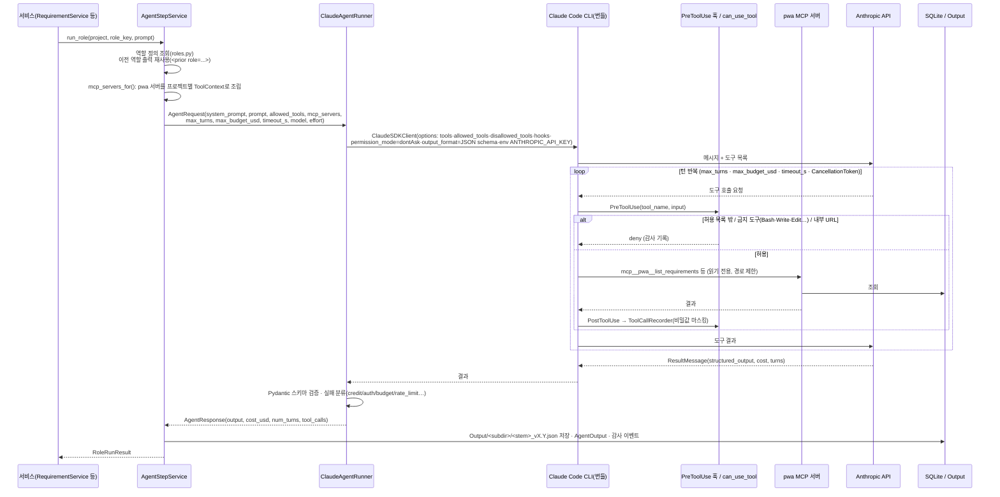
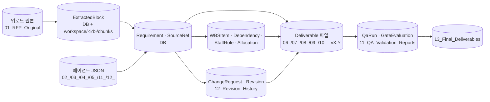

# FLOW_DIAGRAM — 에이전트 · MCP · 도구 · 코드 간 흐름

작성일 2026-10-15 · 구현 기준(`main` a58cf82) · 관련: [AGENT_DESIGN.md](AGENT_DESIGN.md), [MCP_CONFIGURATION.md](MCP_CONFIGURATION.md), [WORKFLOW_DESIGN.md](WORKFLOW_DESIGN.md)

> **스킬에 대하여**: 이 프로그램은 Claude Code의 "스킬(Skill)"이나 서브에이전트(`Agent` 도구)를 사용하지 않는다. 에이전트가 쓸 수 있는 것은 (1) 인프로세스 MCP 서버 `pwa`의 읽기 전용 도구 10종, (2) 기술 조사 역할에만 허용된 내장 `WebSearch`/`WebFetch` 두 가지뿐이다. 파일 생성·ID 발급·일정 계산·QA·게이트 판정은 모두 Python 코드가 수행한다.

---

## 1. 전체 구조 — 누가 누구를 호출하는가

```mermaid
flowchart TB
    subgraph UI["Streamlit UI (ui/app_pages, 8 화면)"]
        H[시작·프로젝트] --> E[문서 추출] --> R[요구사항] --> A[에이전트·조사] --> D[산출물]
        BB[구축: 기준 문서] --> CH[구축: 변경 관리]
    end

    subgraph SVC["서비스 · 오케스트레이터 (Python 코드)"]
        SR[StepRunner<br/>단계 실행 · StepRun 기록]
        GS[GateService<br/>Gate 0~5 코드 판정 · 사람 승인]
        EX[ExtractionService<br/>DOCX/TXT/PDF/OCR → 블록]
        RQ[RequirementService<br/>ID 발급 · 출처 검증 · Gate 1]
        RS[ResearchService<br/>주제 식별 · 출처 신뢰도]
        PL[PlanningService<br/>영업일 일정 · 공수 · 인력]
        GN[GenerationService<br/>Excel 4 · PPT 2 · PNG]
        QA[QaService + independent_qa<br/>독립 검증 30항목 · 자동 재생성]
        BL[BaselineService<br/>기존 Excel 적재 · Revision]
        CS[ChangeService<br/>규칙 의미 비교 · 영향 분석 · 반영]
        AS[AgentStepService<br/>역할 요청 조립 · 이전 출력 재사용 · JSON 저장]
    end

    subgraph AG["에이전트 실행 (agents/)"]
        RN[ClaudeAgentRunner<br/>ClaudeSDKClient · 구조화 출력 · 예산/턴/시간/취소/재시도]
        HK[hooks: PreToolUse 거부 · PostToolUse 기록<br/>can_use_tool 폴백]
        PR[prompts/*.md 10종 + schemas.py]
    end

    subgraph EXT["외부 · 프로세스"]
        CLI[Claude Code CLI 번들 프로세스]
        API[(Anthropic API<br/>ANTHROPIC_API_KEY)]
        WEB[(웹: WebSearch / WebFetch)]
    end

    subgraph MCP["MCP 서버"]
        PWA[pwa 인프로세스 서버<br/>읽기 전용 도구 10종]
        XM[외부 MCP (선택)<br/>PWA_MCP_EXTERNAL]
    end

    subgraph ST["저장소"]
        DB[(SQLite pwa.sqlite3<br/>마이그레이션 0001~0006)]
        FS[(Output/&lt;프로젝트&gt;/00_~13_<br/>FileStore: 덮어쓰기 금지 · 버전명)]
    end

    UI --> SR & GS & BL & CS & GN & QA
    SR --> EX & RQ & RS & PL & GN & QA
    RQ & RS & AS --> RN
    CS -- semantic_differ(선택) --> AS
    QA -- qa_reviewer(선택) --> AS
    GN -- architect/planner 결과 재사용 --> AS
    AS --> RN
    RN --> PR
    RN --> HK
    RN --> CLI --> API
    CLI -- tech_researcher만 --> WEB
    CLI -- mcp__pwa__* --> PWA
    CLI -. 선언된 역할만 .-> XM
    PWA --> DB
    PWA -- verify_deliverable_file --> FS
    SVC --> DB & FS
```

## 2. 에이전트 1회 호출의 내부 흐름 (`AgentStepService.run_role` → `ClaudeAgentRunner`)



실패 시: 일시 오류(rate_limit·overloaded·connection·process)만 `retries` 횟수 재시도, 크레딧·인증·예산·스키마 오류는 즉시 `AgentRunError` → StepRun `failed`. 시간 초과·취소는 `interrupt()`.

## 3. 제안 단계 파이프라인 — 코드 단계와 에이전트 단계, 게이트

```mermaid
flowchart LR
    U[RFP 업로드<br/>01_RFP_Original] --> X[추출(코드)<br/>pdfplumber·docx·OCR]
    X --> G0{{Gate 0<br/>추출 품질}}
    G0 --> RA[[rfp_analyst<br/>pwa: search_source_text, get_source_block]]
    G0 --> RE[[requirement_extractor<br/>도구 없음 · 청크 프롬프트]]
    RE --> ID[ID 발급 · 출처 검증(코드)]
    ID --> RV[[requirement_verifier<br/>별도 세션 · 도구 없음]]
    RV --> G1{{Gate 1<br/>요구사항 기준선<br/>사람 승인}}
    G1 --> TR[[tech_researcher<br/>WebSearch · WebFetch<br/>pwa: get_requirement, list_research]]
    TR --> SRC[출처 신뢰도 재분류 · 미확인 강등(코드)]
    G1 --> AR[[architect<br/>pwa 읽기 9종]]
    AR --> PLN[[planner<br/>pwa 읽기 9종 · 날짜 계산 금지]]
    PLN --> SCH[일정·공수·인력 계산(코드)<br/>planning/*]
    SCH --> GEN[산출물 생성(코드)<br/>구성도 PNG · Excel 4 · PPT 2]
    AR -.기본값 대체.-> GEN
    PLN -.기본값 대체.-> GEN
    GEN --> IQ[통합 QA(코드)<br/>independent_qa 30항목<br/>재생성 자동 수정 ≤ N회]
    IQ -.선택.-> QR[[qa_reviewer<br/>pwa 읽기 + verify_deliverable_file]]
    QR -.사람 검토 항목으로만.-> IQ
    IQ --> G2{{Gate 2 기술}} & G3{{Gate 3 계획}} & G4{{Gate 4 파일}}
    G2 & G3 & G4 --> G5{{Gate 5 최종 독립 QA<br/>사람 승인 필수}}
    G5 --> FIN[최종본 복사<br/>13_Final_Deliverables]
```

- `[[ ]]`는 에이전트(LLM) 단계, 나머지는 Python 코드. `proposal_writer`·`document_generator` 역할도 정의되어 있으며 `run_role_step`으로 호출하면 PPT 문안·문서 계획을 제공하지만, 파일은 항상 코드가 만든다.
- 모든 게이트는 코드가 판정하고 `NEEDS_HUMAN_REVIEW`는 검토 의견을 적은 사람 승인으로만 통과한다. `FAIL`은 승인으로 통과시킬 수 없다.

## 4. 구축 단계 변경관리 흐름

```mermaid
flowchart LR
    UP[기존 Excel 업로드<br/>정의서·추적표·WBS·투입계획] --> MP[구조 분석·컬럼 매핑 제안(코드)<br/>excel_reader: 동의어·유사도]
    MP --> UC{사용자 매핑 확정}
    UC --> LD[기준 적재(코드)<br/>ID 유지 · Revision v1.0 스냅샷]
    LD --> CR[변경 요청 등록<br/>자연어 · 버튼 · 문서 업로드]
    CR --> SEM[규칙 의미 비교(코드)<br/>ADD / MODIFY / DELETE_REQUEST / NO_CHANGE / AMBIGUOUS]
    SEM -.선택.-> SD[[semantic_differ<br/>pwa: list_requirements, get_requirement]]
    SD -.불일치 → AMBIGUOUS.-> SEM
    SEM --> IMP[영향 분석(코드)<br/>전후 일정 · 공수 범위 · 인력 시나리오 1~6 · 비용]
    IMP --> DEC{후보별 수락/거절<br/>사용자 입력은 별도 저장}
    DEC --> APR{승인 / 반려<br/>Approval 기록}
    APR -- 반려 --> KEEP[기준 데이터 불변]
    APR -- 승인 --> APPLY[트랜잭션 반영(코드)<br/>새 ID · 이력 · 삭제 표시 · 추적 재검토 · WBS 갱신 · Revision]
    APPLY --> REGEN[문서 재생성(코드)<br/>Requirements_Definition_YYYYMMDDHHMM.xlsx 등]
    REGEN --> PQA[변경 후 통합 QA(코드)] --> G5b{{Gate 5<br/>사람 승인}}
    APPLY -- 오류 --> RB[롤백 · error 상태 · 재시도]
```

## 5. 역할 ↔ 도구 ↔ MCP 매트릭스

| 역할 | 내장 도구 | pwa MCP 도구 | 출력 스키마 | 호출하는 코드 | 결과를 쓰는 코드 |
|---|---|---|---|---|---|
| rfp_analyst | — | search_source_text, get_source_block | RfpAnalysis | StepRunner.run_rfp_analysis | ResearchService(주제), PlanningService(기간 힌트), 목차 결정 |
| requirement_extractor | — | — | RequirementExtraction | RequirementService.extract | ID 발급·출처 검증 |
| requirement_verifier | — | — | VerificationReport | RequirementService.verify | 지적 사항 → Gate 1 |
| tech_researcher | WebSearch, WebFetch | get_requirement, list_research | ResearchReport | ResearchService.run | 출처 재분류, FeasibilityStudy, QA-TECH 검사 입력 |
| architect | — | 읽기 9종 | ArchitectureDraft | StepRunner.run_role_step | GenerationService(구성 요소·구성도) |
| planner | — | 읽기 9종 | WBSDraft | StepRunner.run_role_step | PlanningService.build_plan(일정은 코드 계산) |
| proposal_writer | — | 읽기 9종 | ProposalContent | StepRunner.run_role_step | PPT 문안·목차 |
| document_generator | — | 읽기 9종 | DocumentPlan | StepRunner.run_role_step | 문서 계획(파일은 코드) |
| qa_reviewer | — | 읽기 9종 + verify_deliverable_file | QaReport | QaService(qa_use_agent) | QA-AI-nn 사람 검토 항목 |
| semantic_differ | — | list_requirements, get_requirement | SemanticDiffDraft | ChangeService.analyze(use_agent) | 규칙 분류에 덧붙임(불일치 시 AMBIGUOUS) |

공통 통제: 금지 도구 `Bash`·`Write`·`Edit`·`NotebookEdit`·`Agent`·`Skill`·`KillShell`, `permission_mode=dontAsk`, 허용 목록 밖 도구는 PreToolUse 훅이 거부, 내부·사설 IP URL 차단, 도구 호출 기록은 비밀값 마스킹, 역할별 턴·예산·시간·재시도 상한.

## 6. 데이터·파일 흐름 (요약)



모든 파일 경로는 `ensure_within`으로 프로젝트 폴더 안으로 제한되고, `FileStore`는 같은 이름을 덮어쓰지 않는다(버전명 또는 `_n`).
