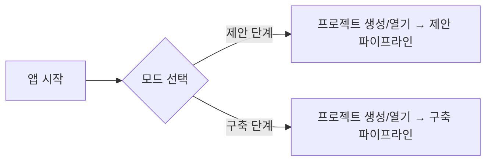

# WORKFLOW_DESIGN — 제안 단계 / 구축 단계 업무 흐름

문서 버전 0.1 · 2026-10-15 · 관련: [ARCHITECTURE.md](ARCHITECTURE.md), [AGENT_DESIGN.md](AGENT_DESIGN.md), [DATA_MODEL.md](DATA_MODEL.md)

---

## 1. 서비스 시작과 모드 선택



- 모드는 `Project.mode`로 저장되며 프로젝트 생성 후 변경 불가 (제안 프로젝트를 구축 모드로 **승계**하는 기능은 "기존 산출물 업로드" 대신 "제안 프로젝트에서 가져오기"로 Phase 6에 제공).
- 모드에 따라 사이드바 메뉴, 입력 문서 종류, 파이프라인 단계, 검증 규칙 세트, 산출물 목록이 바뀐다.

## 1.1 Gate 상태 (Phase 2 구현)

| Gate | 판정 주체 | PASS | NEEDS_HUMAN_REVIEW | FAIL |
|---|---|---|---|---|
| Gate 0 문서 추출 품질 | `ExtractionService.evaluate_gate0` (코드) | 모든 필수 문서가 success, 검토 필요 블록 0 | 일부 페이지 저품질(partial), OCR 저신뢰 블록, 빈 페이지 30% 초과, OCR 비율 50% 이상 | 필수 문서 미등록·미추출·추출 실패·텍스트 없음 |
| Gate 1 요구사항 추출·독립 검증 | `RequirementService.evaluate_gate1` (코드) | 모든 요구사항 검증 완료, 미해결 error 0, 기각·불확실 필수 항목 없음 | error 지적, 기각된 항목, 필수 항목 신뢰도 < 0.6 또는 수정 필요, 출처 없는 필수/지원 항목 | 요구사항 0건, 미검증 항목 존재 |

- `NEEDS_HUMAN_REVIEW`는 사람이 **의견을 기록하고** 승인해야 PASS가 된다(`GateService.approve_human_review`). `FAIL`은 승인으로 넘길 수 없고 재처리 후 재평가해야 한다.
- 오케스트레이터(`StepRunner`)는 요구사항 추출 전에 Gate 0, 제안서 생성 단계 전에 Gate 1을 `GateService.require()`로 검사한다. 에이전트가 자연어로 "통과"라고 해도 효력이 없다.

## 2. 파이프라인 공통 규칙

- 각 단계(Step)는 `입력 조건 → 실행 → 결과 저장(draft) → 자동 검증 → (승인 게이트) → 다음 단계`로 구성.
- 단계 상태: `pending / running / needs_review / approved / failed / skipped`.
- 재실행: 단계는 멱등적으로 재실행 가능. 재실행은 새 draft를 만들고 기존 승인 데이터는 보존.
- 모든 단계는 `AuditEvent`를 남기고, 에이전트 단계는 비용을 기록.

## 3. 제안 단계 워크플로우

```mermaid
flowchart TD
    A1[1. 프로젝트 생성<br/>이름·발주처·기간 입력] --> A2[2. RFP 업로드<br/>PDF/DOCX/HWP→PDF]
    A2 --> A3[3. 문서 추출<br/>텍스트/OCR, 청크, 출처 좌표]
    A3 --> A4[4. RFP 분석 (P1)]
    A4 --> A5[5. 요구사항 추출 (P2)<br/>ID 발급 (코드)]
    A5 --> A6[6. 독립 검증 (P3)]
    A6 --> G1{{검토·승인 게이트 1<br/>요구사항 기준선}}
    G1 -->|수정| A5
    G1 -->|승인| A7[7. 기술 조사·구현 가능성 (P4)]
    A7 --> G2{{게이트 2<br/>조사 결과 검토}}
    G2 --> A8[8. 아키텍처 설계 (P5)]
    A8 --> A9[9. WBS·공수 제안 (P6)<br/>→ 일정 계산 (코드)]
    A9 --> A10[10. 인력 투입계획 (코드)]
    A10 --> G3{{게이트 3<br/>계획 승인}}
    G3 --> A11[11. 문서 생성<br/>Excel 4종·다이어그램 3종]
    A11 --> A12[12. 제안 문안 작성 (P7)<br/>제출용/발표용 PPT 생성]
    A12 --> A13[13. 무결성 검사 (코드)<br/>+ QA (P8)]
    A13 --> G4{{게이트 4<br/>최종 승인}}
    G4 -->|수정| A11
    G4 -->|승인| A14[14. 13_Final_Deliverables 복사<br/>Revision 확정, 요약 생성]
```

### 단계별 상세

| 단계 | 주체 | 입력 | 산출(저장 위치) | 자동 검증 |
|---|---|---|---|---|
| 1 프로젝트 생성 | UI/코드 | 이름, 발주처, 예상 기간 | Project, Output 폴더 14종 | 폴더 중복 → 식별자 추가 |
| 2 RFP 업로드 | UI/코드 | 파일 | `01_RFP_Original/` 복사, SourceDocument(sha256) | 확장자·크기·중복 |
| 3 문서 추출 | ingest | SourceDocument | `workspace/<prj>/chunks/*.json` | 추출 텍스트 비율 < 임계 → OCR 전환 제안 |
| 4 RFP 분석 | P1 | 청크 | `02_RFP_Analysis/rfp_analysis_v1.0.md` + JSON | 스키마 |
| 5 요구사항 추출 | P2 + `id_policy` | 분석 + 청크 | Requirement(draft) | 출처 누락 → error, 중복 후보 → warning |
| 6 독립 검증 | P3 | Requirement(draft) | ValidationResult, verification_status | `rejected` 항목 있으면 게이트에서 강조 |
| G1 승인 | 사용자 | 요구사항 표(편집 가능) | Approval, status=baseline, Revision v1.0, `03_Requirements/` 스냅샷 | 미검증 항목 승인 시 경고 |
| 7 기술 조사 | P4 | baseline 요구사항 | TechnologyResearch, `04_Technology_Research/` | 출처 0건 → warning; `infeasible` → 게이트 강조 |
| 8 아키텍처 | P5 | 요구사항+조사 | ArchitectureComponent, `05_Architecture_Design/architecture_v1.0.json` | 연결 참조 무결성 |
| 9 WBS·일정 | P6 → scheduler | 요구사항+아키텍처+기간 | WBSItem, Dependency, `06_WBS_Effort_Schedule/wbs_v1.0.json` | 순환 의존 거부, 근거 누락 error, 기간 초과 warning |
| 10 인력 계획 | staffing | WBS | StaffRole, StaffingAllocation, `06_WBS_Effort_Schedule/staffing_v1.0.json` | 배정 합 ≠ 공수 → error |
| G3 승인 | 사용자 | 간트 미리보기, 공수 표 | Approval | |
| 11 문서 생성 | generators | 기준 데이터 | `09_Excel_Deliverables/`, `10_Diagrams_Charts_Images/`, Deliverable | 파일 재오픈·필수 시트/컬럼 |
| 12 PPT | P7 + pptx generator | 기준 데이터 + 문안 | `07_…/`, `08_…/` | 슬라이드 수, 이미지 참조 존재 |
| 13 QA | validation + P8 | Deliverable | `11_QA_Validation_Reports/qa_report_v1.0.md` | error 0건이어야 G4 가능 |
| 14 확정 | 코드 | 승인 | `13_Final_Deliverables/`, `00_Project_Summary/`, `12_Revision_History/` | sha256 일치 |

### 요구사항 ID 규칙 (`requirements/id_policy.py`)

- 형식: `REQ-F-###`(기능), `REQ-N-###`(비기능). 프로젝트 내 단조 증가, DB `sequence` 테이블로 관리.
- 추출 재실행 시 기존 draft와 `name+rfp_quote` 유사도(코드: 정규화 문자열 비교)로 매칭되면 기존 ID 유지, 아니면 새 ID.
- 승인 후 삭제는 `status=deleted`, ID는 영구 예약.

## 4. 구축 단계 워크플로우

```mermaid
flowchart TD
    B1[1. 프로젝트 생성 (구축 모드)] --> B2[2. 기존 산출물 업로드<br/>요구사항정의서·추적표·WBS·인력계획 Excel]
    B2 --> B3[3. 문서 구조 분석 (B1)<br/>컬럼 매핑 제안 → 사용자 확정]
    B3 --> B4[4. 기준 데이터 적재 (코드)<br/>Requirement/Trace/WBS/Staffing, Revision v1.0]
    B4 --> B5[5. 요구사항 조회 화면]
    B5 --> B6[6. 변경 요청 등록<br/>추가/변경/삭제]
    B6 --> B7[7. 결정적 비교 (코드)<br/>필드 diff, 유사 후보 선별]
    B7 --> B8[8. 의미 비교 (B2)]
    B8 --> B9[9. 영향 식별 (코드: 추적·의존 그래프)<br/>+ 영향 분석 (B3)]
    B9 --> B10[10. 일정·공수·인력·비용 재계산 (코드)]
    B10 --> G5{{승인 게이트<br/>변경 승인/반려}}
    G5 -->|반려| B5
    G5 -->|승인| B11[11. 기준 데이터 적용<br/>Requirement 갱신, RequirementChange=applied]
    B11 --> B12[12. 문서 갱신 (B4 + generators)<br/>새 버전 파일 vN.m]
    B12 --> B13[13. 무결성·QA (코드 + B5)]
    B13 --> G6{{최종 QA 승인}}
    G6 --> B14[14. Revision vN.m 확정<br/>12_Revision_History 스냅샷, 변경 이력 보존]
```

### 핵심 규칙

- **승인 전 기준 데이터 불변**: 7~10단계 결과는 `RequirementChange.impact`에만 저장. `Requirement` 레코드는 G5 승인 후 11단계에서만 갱신.
- **기존 파일 보존**: 업로드 원본은 `01_RFP_Original/`(구축 모드에서는 `01_Baseline_Original` 라벨로 표시하되 폴더명은 동일 유지)에 복사. 갱신 문서는 항상 새 버전명(`요구사항정의서_v1.1.xlsx`).
- **영향 식별의 2원화**: 코드가 추적표(`RequirementTrace`)와 의존(`Dependency`) 그래프로 결정적 영향 집합을 만들고, 에이전트는 의미적 추가 후보를 **별도 라벨(`suggested_by_agent`)**로 제안. UI에서 구분 표시.
- **수치의 출처**: 일정·공수·비용 변화량은 `planning/*` 재계산 값만 사용. 에이전트 추정치는 `basis` 참고용으로 저장.
- **변경 이력**: `RequirementChange`(before/after 스냅샷) + `Revision`(전체 스냅샷 JSON) + 생성 문서 내 "변경 이력" 시트 자동 기재.

### 기존 산출물 파싱 전략

1. 업로드 Excel의 각 시트 헤더와 샘플 행을 B1 에이전트에 전달해 `target_field` 매핑 제안을 받는다.
2. 사용자가 매핑 UI에서 확정한다. 확정 매핑은 `SourceDocument.column_mapping`과 **템플릿 프로파일**(`config/templates/<client>.json`)로 저장해 재사용한다.
3. `ingest/excel_reader.py`가 매핑에 따라 결정적으로 파싱한다. 필수 필드(요구사항 ID, 이름, 내용) 누락 행은 오류 목록으로 보고하고 적재하지 않는다.
4. 기존 ID 체계가 `REQ-F-###`와 다르면 **원본 ID를 그대로 유지**한다(재발급 금지). 신규 추가분만 원본 체계를 분석해 같은 접두·자리수로 이어서 발급한다.

## 5. 승인 게이트 UI 공통 요소

- 대상 요약 표(편집 가능 컬럼 제한), 검증 결과(level별 필터), 에이전트 근거·출처 패널, 비용 누적.
- 결정: 승인 / 의견과 함께 승인 / 반려(사유 필수). `Approval` 저장.
- 승인자 이름은 설정값 또는 입력값(`created_by`).

## 6. 산출물 ↔ 데이터 매핑

| 산출물 | 생성기 | 원천 데이터 | 필수 시트/구성 |
|---|---|---|---|
| 요구사항 정의서 .xlsx | `generators/excel/requirement_spec.py` | Requirement | `요구사항목록`(ID, 구분, 분류, 명, 상세, 구현방안, 수용상태, 범위, 출처, 상태), `변경이력` |
| 요구사항 추적표 .xlsx | `excel/trace_matrix.py` | RequirementTrace + Screen/WBS/UT/IT | `추적표`(요구사항 × 화면/WBS/단위/통합), `미추적` |
| WBS·간트 .xlsx | `excel/wbs_gantt.py` | WBSItem, Dependency | `WBS`, `간트`(주 단위 셀 채움), `의존관계`, `산정근거` |
| 인력 투입계획 .xlsx | `excel/staffing_plan.py` | StaffRole, StaffingAllocation | `투입계획`(월별 M/M), `공수요약`, `단가·비용`(선택) |
| 제출용 PPT | `pptx/submission.py` | ProposalContent + 다이어그램 PNG + 표 | 표지, 목차, 사업 이해, 요구사항 대응, 아키텍처, 일정, 인력, 품질·위험 |
| 발표용 PPT | `pptx/presentation.py` | ProposalContent(발표 프로필) | 요약 중심, 발표자 노트 |
| 구성도 PNG ×3 | `diagrams/*.py` (matplotlib) | ArchitectureComponent | 레이어 박스 + 연결선 |
| 프로젝트 요약 .md | `summary.py` | 전체 | |
| QA 보고서 .md | validation + P8 | ValidationResult | |
